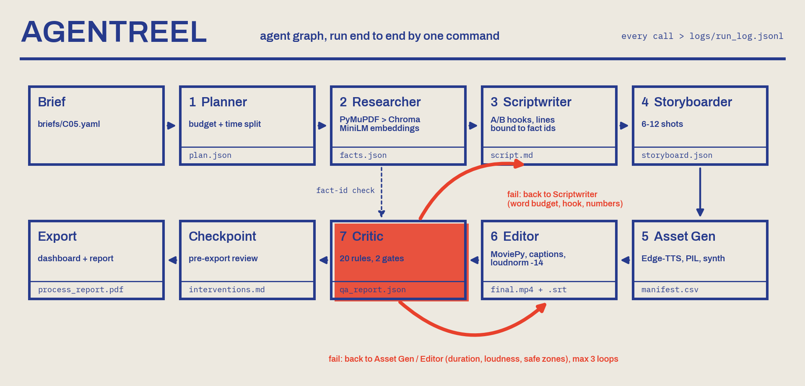

# AgentReel · Group 19 (G19)

**SOMAIYA AGENTREEL CHALLENGE — LY Agentic AI Laboratory, K J Somaiya School of Engineering**

| Team G19 (Group 19) | Roll number |
|---|---|
| Harshit Modi | 16014223039 |
| Mohammed Zamee Sheikh | 16014223054 |
| Eashan Salian | 16014223035 |

A reusable, brief-agnostic multi-agent pipeline. You give it a sealed brief (`briefs/<id>.yaml`); seven agents
research, script, storyboard, generate, edit and quality-check a 9:16 promotional reel (30–60 s). Every model
and tool call is logged, costed and hashed.

| | |
|---|---|
| **Live-run brief** | **C05** · Responsible AI Usage · *AI-ready graduate: how the curriculum and labs build industry AI skills* |
| **Autonomy level** | **L3 — Checkpointed autonomy.** One command runs end to end; the Critic self-repairs through two gates; a human reviews once before export (mandatory for Category A/C — logged, not counted). |
| **Run command** | `python run.py --brief briefs/C05.yaml --seed 42` |
| **Final output** | `outputs/G19_C05_final.mp4` + `outputs/G19_C05_final.srt` + `outputs/qa_report.json` |
| **Report** | `docs/process_report.pdf` (generated automatically at the end of every run) |
| **Dashboard** | `frontend/index.html` (open in a browser after a run) |

---

## 1. Agent graph



```
Brief ─► Planner ─► Researcher (RAG) ─► Scriptwriter ◄─► Critic·script-gate
                                              │
                                              ▼
                   Storyboarder ─► Asset Generator ─► Editor ─► Critic·video-gate
                                        ▲                           │ fail (≤3 loops)
                                        └───────────────────────────┘
                                                                    │ pass
                                          Human checkpoint ─► Export (frontend, graph, report)
```

| # | Agent | File | What it does | Output |
|---|---|---|---|---|
| 1 | Planner | `agents/planner.py` | Parses the brief; format spec, VO seconds, word budget, shot count, ₹ and minute budget per stage, success criteria | `outputs/plan.json` |
| 2 | Researcher (RAG) | `agents/researcher.py` | PyMuPDF → LangChain splitter → **ChromaDB + all-MiniLM-L6-v2**; one query per information need; verbatim claims with **source + page**; 10-question retrieval smoke test | `outputs/facts.json`, `outputs/retrieval_test.json` |
| 3 | Scriptwriter | `agents/scriptwriter.py` | A/B/C hook variants scored for the 3-second rule; body lines are bound to fact ids (a line is only written if its facts exist); drops lowest-priority lines on Critic feedback | `outputs/script.md`, `outputs/script.json` |
| 4 | Storyboarder | `agents/storyboarder.py` | 6–12 face-free shots + 4 s end card: on-screen text, visual, style, duration, asset source | `outputs/storyboard.json` |
| 5 | Asset Generator | `agents/asset_generator.py` | Edge-TTS VO **with word timings**, procedural visuals (official media kit used first if present), procedural music bed, licence manifest | `assets/generated/`, `assets/manifest.csv` |
| 6 | Editor | `agents/editor.py` | MoviePy: Ken Burns, cross-dissolves, headline + **karaoke captions inside safe zones**, ducked music, end card with CTA + AI disclosure, **2-pass loudnorm to −14 LUFS** | `outputs/G19_C05_final.mp4/.srt`, `outputs/edit_meta.json`, `outputs/frames/` |
| 7 | Critic / QA | `agents/critic.py` | 20 deterministic rules in two gates (script gate before any asset is made; video gate on the real MP4 via ffmpeg probe). Each failure names the agent to route back to; max 3 loops | `outputs/qa_report.json` |

### Critic rules

| Gate | Rules |
|---|---|
| Script | S1 word budget · S2 hook ≤ 3 s · S3 every body line cites a verified fact · S4 no number absent from facts.json · S5 no placement/ranking hype (LPA, crore, %, #1…) · S6 lab infrastructure mentioned · S7 deployment mentioned · S8 exact CTA |
| Video | V1 30–60 s · V2 brief duration ±20 % · V3 1080×1920 · V4 30 fps · V5 H.264 High yuv420p · V6 AAC 48 kHz stereo 128–192 kbps · V7 ≤ 100 MB · V8 −14 ±1.5 LUFS · V9 captions + .srt · V10 safe zones (top 250 / bottom 350 px) · V11 hook in first 3 s · V12 end card CTA + "Created with AI agents — LY Agentic AI Lab" |

**Self-repair actually exercised in the live run:** the first script draft was over the word budget → Critic S1 failed
→ Scriptwriter v2 dropped the two/three lowest-priority lines → pass. If the rendered video overruns the brief
duration, the orchestrator re-voices at a faster TTS rate instead of cutting grounded lines.

## 2. Repository layout

```
agentreel-G19/
├── README.md              # this file
├── run.py                 # one-command entry point (orchestrator)
├── generate_report.py     # builds docs/process_report.pdf from logs + outputs
├── requirements.txt       # pinned versions
├── .env.example           # key names only, never real keys
├── briefs/                # C05.yaml (live) · P00.yaml (practice brief, handout §11.4)
├── agents/                # planner, researcher, scriptwriter, storyboarder, asset_generator, editor, critic,
│                          # llm (provider wrapper), common (schemas + logging), graph (agent_graph.png)
├── prompts/               # versioned prompt templates (planner_v1, researcher_v1, scriptwriter_v2, ...)
├── data/                  # LY_AgenticAI_Lab_Handout.pdf - the official source document
├── assets/                # fonts (OFL), generated/ (VO, images, music), official/ (drop media kit here),
│                          # manifest.csv (source + licence of every asset)
├── outputs/               # G19_C05_final.mp4 / .srt / qa_report.json / plan / facts / script / storyboard / frames
├── logs/                  # run_log.jsonl · cost_report.csv · interventions.md
├── docs/                  # agent_graph.png · process_report.pdf · screenshots/
├── frontend/              # index.html dashboard + data.js (written by run.py)
└── tools/                 # build_source_pdf.py (docx handout -> data/*.pdf)
```

## 3. Setup

Python 3.10+ (developed on 3.12, Windows 11). FFmpeg is bundled through `imageio-ffmpeg`; nothing to install system-wide.

```bash
python -m venv .venv
.venv\Scripts\activate          # Windows   (macOS/Linux: source .venv/bin/activate)
pip install -r requirements.txt
copy .env.example .env          # optional: choose an LLM provider / voice
```

Internet is needed for Edge-TTS and the first download of the MiniLM embedding model (~90 MB, cached afterwards).

## 4. Run

```bash
python run.py --brief briefs/C05.yaml --seed 42
```

* Interactive terminal → the pipeline pauses once at the **pre-export review checkpoint** (`Approve export? [Y/n]`).
  Use `--auto-approve` for unattended runs (it is logged as auto-approved).
* Practice brief: `python run.py --brief briefs/P00.yaml --seed 42`
* Rebuild only the report: `python generate_report.py`
* Open `frontend/index.html` in a browser to explore the run (video, agent stats, facts, script, storyboard, QA, cost, logs).
* Re-running with the same seed reproduces the same plan, facts, script and storyboard byte-for-byte (offline
  provider); TTS audio can differ by a few milliseconds because it comes from a network service.

### LLM providers (`.env`)

| `LLM_PROVIDER` | Model (default) | Cost |
|---|---|---|
| `offline` *(default)* | seeded template model, deterministic | ₹0 |
| `anthropic` | `claude-haiku-5-5` (set `ANTHROPIC_API_KEY`) | ≈ ₹1–2 / run |
| `openai` | `gpt-4o-mini` (set `OPENAI_API_KEY`) | < ₹1 / run |
| `ollama` | `qwen2.5:7b-instruct` on `OLLAMA_BASE_URL` | ₹0 (local) |

Any hosted failure falls back to the offline model and the fallback is written to the log — never silent.

## 5. Logging & cost

Every call goes through `agents/common.log_call` → one line in `logs/run_log.jsonl`:

```json
{"ts":"2026-10-22T20:01:13","run_id":"G19-C05-01","agent":"scriptwriter","tool":"llm","model":"offline-template",
 "prompt_id":"scriptwriter_v2","input_tokens":1270,"output_tokens":905,"cost_inr":0.0,"latency_s":0.002,
 "status":"ok","output_path":null,"output_sha256":null,"human_intervention":false}
```

and a roll-up row in `logs/cost_report.csv` (`stage, provider, model, tool, units, tokens, cost_inr, latency_s`).
Output files are SHA-256 hashed so hand-edited artefacts are detectable. Human actions go to `logs/interventions.md`.
Logs from build-phase dry runs are kept in `logs/build_phase/`.

## 6. Results (run G19-C05-01, brief C05)

| Metric | Result | Rule |
|---|---|---|
| Duration | **51.1 s** | 30–60 s, brief 45 s ±20 % |
| Video | 1080×1920 · 30 fps · H.264 High · yuv420p · 31.9 MB | spec §5.1 |
| Audio | AAC 48 kHz stereo 163 kb/s · **−14.3 LUFS** | ≈ −14 LUFS |
| Captions | 36 burned-in karaoke cues (Archivo ExtraBold 60 px) + `.srt` | ≥ 48 px, safe zones |
| Grounding | 14 facts, all verified, every body line cites a fact id | no fabricated facts |
| Critic loops | script gate 2 (127 → 98 words), video gate 1 | ≤ 3 |
| QA | **20 / 20 rules pass** | — |
| Spend / time | **₹0.00** of ₹500 · 3.2 min of 180 | budget + 3 h |
| Human interventions | **0** (+1 mandatory pre-export checkpoint, not counted) | ≤ 5 |

Full tables are in `docs/process_report.pdf`; every number above is regenerated per run in `outputs/qa_report.json`.

### Submission reel (HyperFrames)

`brag-output/` holds the polished submission cut of the same run, made with the /brag + HyperFrames workflow:
`build_reel.py` reads this run's timeline, captions, logs, facts and QA report and writes an HTML-to-video
composition (`brag-output/composition/`) whose scenes show the pipeline's real artefacts (brief card, agent lane,
run log, QA checklist, rendered frames). It reuses the pipeline's own VO + music mix, so the same `.srt` fits both cuts.

```bash
python brag-output/build_reel.py
cd brag-output/composition && npx hyperframes check && npx hyperframes render -o ../brag.mp4   # needs ffmpeg on PATH
```

## 7. Visual system

Everything (generated stills, Editor overlays, end card, agent graph, dashboard, report, HyperFrames reel) is
printed in one deliberate medium: a **two-ink risograph** on newsprint (`agents/riso.py`).

* **Paper** `#EDE9E0` with fibre noise. **Blue** `#263A8C` carries every word and every structural line.
* **Scarlet** `#E8412C` is the one accent per frame, printed on its own plate 5 px off register; where it overlaps
  the blue the plates multiply (`#220F18`).
* Shading is halftone dots, never gradients; no glow, no glass, no dark void. Type is **Archivo** (variable
  width/weight): black + expanded for display, regular for reading; JetBrains Mono only for real code and logs.

## 8. Responsible-AI notes

* **Grounding:** the only factual source is the official lab handout in `data/`. No hardware specs, rankings or
  placement data are claimed. If `data/` is empty, a mock fact sheet is used but every mock fact is `verified=false`
  and Critic rule S3 blocks it from the video.
* **No real likeness:** visuals are procedural and face-free; the voice is a stock synthetic Edge-TTS voice.
* **Disclosure:** the end card carries "Created with AI agents — LY Agentic AI Lab".
* **Licensing:** fonts SIL OFL 1.1 (Archivo, JetBrains Mono, IBM Plex); music generated by the
  pipeline (CC0); every asset listed in `assets/manifest.csv`.
* **Brand:** put the official logo at `assets/official/logo.png` and media-kit stills at
  `assets/official/S0X.png`; the Editor/Asset Generator use them unmodified instead of generated stand-ins.
* **Keys/data:** `.env` is git-ignored; no personal data is used in prompts.

## 9. Credits

Open-source libraries: MoviePy, imageio-ffmpeg/FFmpeg, edge-tts, ChromaDB, sentence-transformers
(all-MiniLM-L6-v2), LangChain text splitters, PyMuPDF, pydantic, fpdf2, Pillow, NumPy, Matplotlib.
Fonts from Google Fonts / IBM Plex (OFL). The companion promo reel in the submission (`G19_C05_final.mp4`) was
composed with HyperFrames (HTML-to-video) from this pipeline's script, storyboard and voice-over.
Built with help from Claude Code (AI coding assistant).
